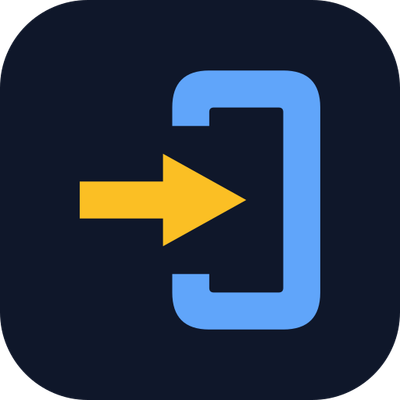

# appforshare-mcp

[](https://mcptry.com/servers/io.appforshare/appforshare)



MCP server for [AppForShare](https://appforshare.io). Lets Claude Code, Cursor, Codex, VS Code, Gemini CLI and other
MCP clients upload iOS and Android builds, find install links, read the store readiness check and follow App Store
and Google Play releases and reviews.

Needs an AppForShare API token (Pro and Team), from https://appforshare.io/dashboard/settings, and Node 18 or newer.

```json
{
  "mcpServers": {
    "appforshare": {
      "command": "npx",
      "args": ["-y", "appforshare-mcp"],
      "env": { "APPFORSHARE_TOKEN": "afs_your_token" }
    }
  }
}
```

Claude Code:

```sh
claude mcp add appforshare --env APPFORSHARE_TOKEN=afs_your_token -- npx -y appforshare-mcp
```

No local uploads needed? Use the hosted server instead: `https://appforshare.io/api/mcp`, with OAuth (Claude, ChatGPT and other clients that sign in) or the header `Authorization: Bearer afs_your_token`. Setup for each client: https://appforshare.io/docs/mcp

## Tools

| Tool | What it does |
|---|---|
| `upload_build` | Upload a local .ipa, .apk or .aab (release notes, channel). Returns the install link and readiness result. |
| `list_builds`, `latest_build` | Builds with install links, filtered by platform, app, project or channel. |
| `build_info` | One build with every store readiness finding and its fix. |
| `list_projects`, `whoami` | Projects in the account; account, plan and role of the token. |
| `release_status`, `list_reviews` | App Store and Google Play release status and reviews. Read only. |
| `promote_build`, `delete_build` | Change a channel or delete a build. Developer role and `confirm: true` required. |

Environment: `APPFORSHARE_TOKEN` (required), `APPFORSHARE_API` (default `https://appforshare.io`).

## Agent skill

[`skills/appforshare`](skills/appforshare) is an agent skill (a folder with a `SKILL.md`) that tells Claude Code,
Codex and other agents that load skills when to upload, which tools and CLI flags to use, how to read the store
readiness result, and which actions need the person's confirmation. It points to the hosted OAuth server first and
to `npx appforshare` as the fallback. Copy the folder to `~/.claude/skills/` (Claude Code, all projects),
`.claude/skills/` in a project, or `~/.agents/skills/` (Codex). Free to use; the tools it calls need Pro or Team.

MIT licence.

## Registry

Listed in the official MCP Registry as `io.appforshare/appforshare`.
